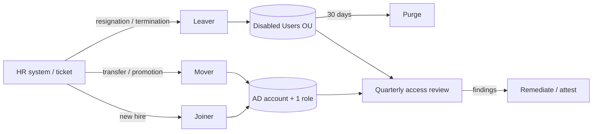

# 05 – Joiner-Mover-Leaver runbook

Every lifecycle event starts from an **HR ticket** (simulated `HR-xxxx`). No ticket, no change.
All actions are written to `C:\IAMLab\logs\audit-log.csv` with the ticket ID.



---

## Joiner — `Invoke-Joiner.ps1`

**Input:** first/last name, department, role, title, manager, employee ID, ticket. Single or CSV bulk.

| # | Step | Control |
|---|---|---|
| 1 | Validate department & role exist | Only approved roles can be requested |
| 2 | Validate **role belongs to department** | Stops "HR recruiter gets Finance access" (row 3 in `new-hires.csv` is rejected) |
| 3 | Validate manager exists, employee ID unique | Accountability, no duplicate identities |
| 4 | Generate `sAMAccountName` by naming standard | Consistent, collision-safe |
| 5 | Create in department OU, temp password, *change at next logon* | Admin never knows the user's real password |
| 6 | Add **one** role group | Access only via RBAC |
| 7 | SoD check | Preventive control |
| 8 | Audit log | Evidence |

```powershell
.\Invoke-Joiner.ps1 -FirstName Siti -LastName Rahma -Department FIN -Role RG-FIN-Staff `
    -Title 'Accounts Payable Officer' -Manager dpratama -EmployeeId E1010 -TicketId HR-1001
```

## Mover — `Invoke-Mover.ps1`

The risk is **privilege creep**: old access stays, new access is added, and after three transfers
one person can see everything.

| # | Step | Control |
|---|---|---|
| 1 | Reject if account disabled | Rehire is a different process |
| 2 | Log *before* snapshot of groups | Evidence |
| 3 | **Remove all RG-* roles** | Privilege-creep prevention |
| 4 | Move to new department OU, update title/manager | Correct GPOs apply, correct approver |
| 5 | Add new role | Access via RBAC |
| 6 | Warn about ad-hoc (non-role) memberships — kept but flagged | New manager must re-approve |
| 7 | SoD check, *after* snapshot | Preventive control + evidence |

```powershell
.\Invoke-Mover.ps1 -SamAccountName sputri -NewDepartment FIN -NewRole RG-FIN-Staff `
    -NewTitle 'Finance Analyst' -NewManager dpratama -TicketId HR-1007
```

## Leaver — `Invoke-Leaver.ps1`

**Disable first, delete later.**

| # | Step | Control |
|---|---|---|
| 1 | Save JSON snapshot of all groups, OU, manager | Reversible if HR made a mistake; audit evidence |
| 2 | Disable account | Immediate loss of access |
| 3 | Reset password to a random value | Kills any shared/known password |
| 4 | Remove every group membership | No dormant access if re-enabled by mistake |
| 5 | Stamp description `LEAVER <date> <ticket>`, clear manager, move to Disabled Users | Easy to identify; no user GPOs |
| 6 | `-PurgeOlderThanDays 30` deletes accounts parked > 30 days | Data minimisation |

```powershell
.\Invoke-Leaver.ps1 -SamAccountName bwijaya -TicketId HR-1012
.\Invoke-Leaver.ps1 -PurgeOlderThanDays 30 -WhatIf
```

**Restore a wrongly-offboarded user:** read the JSON snapshot in
`C:\IAMLab\logs\leaver-snapshots\`, enable the account, move back to `OriginalOU`, re-add `Groups`.

---

## Audit log sample

```
TimestampUtc,Event,TicketId,Target,Action,Detail,PerformedBy
2026-10-25T03:12:40Z,JOINER,HR-1001,srahma,Account created,OU=FIN; Role=RG-FIN-Staff; Manager=dpratama,NUSANTARA\Administrator
2026-10-25T03:14:02Z,MOVER,HR-1007,sputri,Removed role RG-SLS-Staff,,NUSANTARA\Administrator
2026-10-25T03:14:03Z,MOVER,HR-1007,sputri,Added role RG-FIN-Staff,Moved to OU=FIN,NUSANTARA\Administrator
2026-10-25T03:15:21Z,LEAVER,HR-1012,bwijaya,Disabled + password scrambled,,NUSANTARA\Administrator
```
*(Replace with your real output after running the demo.)*
